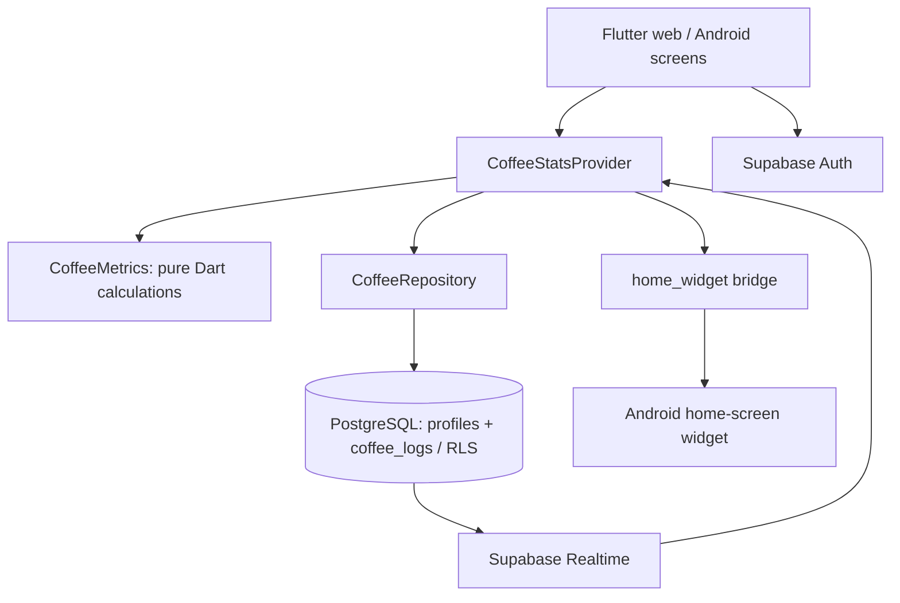

# CaffAlert

A web-first coffee diary that turns your daily coffee rhythm into a playful CAF countdown and clear personal statistics.

Built by **František Bujnovský**, web analyst working with GA4, GTM, SQL and data quality. The [analytics case study](docs/case-study.md) explains the event model, metric definitions, security boundaries and example SQL analyses.

**Live demo:** [caff-alert.netlify.app](https://caff-alert.netlify.app)

[Česká dokumentace a provozní poznámky](docs/README.cs.md)

## What it does

Log a coffee, watch a four-hour countdown, and review your daily rhythm across devices with a Supabase account. Web is the primary platform; Android adds a home-screen widget.

- Email sign-up, sign-in, password recovery and account deletion.
- One-tap coffee logging, undo of the latest entry, and correction/removal of recent entries in the UI.
- Today, month and total counts; first/last coffee today and average interval.
- Realtime refresh of coffee records across signed-in clients.
- Responsive layouts, Czech/English interface and editable display name.
- Android widget showing the latest coffee countdown.

<!-- screenshot: web-dashboard -->
Web dashboard — TODO: `docs/screenshots/web-dashboard.png`.

<!-- screenshot: android -->
Android app — TODO: `docs/screenshots/android.png`.

<!-- screenshot: widget -->
Home-screen widget — TODO: `docs/screenshots/widget.png`.

## Stack and architecture

Flutter **3.47.9** / Dart, Provider, Supabase Auth + PostgreSQL + Realtime, `home_widget` for Android, and optional Sentry error reporting. Netlify builds and serves the web application and static privacy/account-deletion pages.



## How CAF level works

CAF level is a fictional game metric, **not medical advice or a measurement of caffeine in the body**. It only uses time since the latest recorded coffee; drinks do not stack and no caffeine dose is stored.

With `D = 4 hours`, `elapsed = now UTC − latest coffee UTC`:

```text
remaining = max(0, D − elapsed)
CAF % = clamp(round(100 × remaining milliseconds / D milliseconds), 0, 100)
```

No records means zero. A coffee recorded one hour ago gives 75%; after four hours it gives 0%. Removing the latest entry resumes the countdown from the previous entry. `CAFF_LEVEL_DURATION_SECONDS` can override the duration at build time; non-positive values fall back to four hours. See [all metric definitions and edge cases](docs/case-study.md#metric-definitions).

## Quick start

Prerequisites: Flutter **3.47.9** (also pinned in `netlify_build.sh` and workflows), Node.js 20+, and a running Docker-compatible runtime. Commands below use only local Supabase.

```sh
git clone https://github.com/bujnovskyf/caffAlert.git
cd caffAlert
npm ci
npm run db:start
npm run db:reset
npm run db:test
cp .env.example .env
npx supabase status
```

Copy the local API URL and local `anon` key from status into `.env` as `SUPABASE_URL` and `SUPABASE_PUBLISHABLE_KEY`. The latter accepts the local legacy anon key as well as a publishable key. Leave `SENTRY_DSN` empty for local development.

```sh
flutter pub get
flutter run -d chrome --web-port 8765 --dart-define-from-file=.env
```

Confirmation and recovery emails appear in local Mailpit at `http://localhost:54324`. Stop the local stack with `npx supabase stop`. Resetting the local database discards its data. See the [Czech operations guide](docs/README.cs.md) for Netlify and deployment configuration.

## Android install and build

Download `app-release.apk` from [GitHub Releases](https://github.com/bujnovskyf/caffAlert/releases) when a release is available. Open it on Android and allow installation from that download source if prompted. Add the CaffAlert widget through your launcher's widget picker after signing in and recording a coffee.

Build a debug APK yourself with the same `.env` configuration:

```sh
flutter build apk --debug --dart-define-from-file=.env
```

Output: `build/app/outputs/flutter-apk/app-debug.apk`. For a physical phone, the Supabase URL must be reachable from that phone; its `localhost` refers to the phone itself. The standard Android emulator reaches the host at `10.0.2.2`.

For a signed release, create an untracked `android/key.properties`:

```properties
storeFile=/absolute/path/to/upload-keystore.jks
storePassword=<keystore password>
keyAlias=<key alias>
keyPassword=<key password>
```

```sh
flutter build apk --release --dart-define-from-file=.env
```

Output: `build/app/outputs/flutter-apk/app-release.apk`. `android/app/build.gradle.kts` reads these four properties; without the file it does not fall back to debug signing.

### Release automation

The [release workflow](.github/workflows/release.yml) runs on tags matching `v*`, builds with JDK 17 and Flutter 3.47.9, and attaches the signed APK to the matching GitHub Release. Configure these repository secrets before tagging:

| Secret | Purpose |
| --- | --- |
| `ANDROID_KEYSTORE_BASE64` | Base64-encoded signing keystore |
| `ANDROID_KEYSTORE_PASSWORD` | Keystore password |
| `ANDROID_KEY_ALIAS` | Signing key alias |
| `ANDROID_KEY_PASSWORD` | Signing key password |
| `SUPABASE_URL` | Backend URL compiled into the release |
| `SUPABASE_PUBLISHABLE_KEY` | Public client key compiled into the release |

The workflow creates `.env` and `android/key.properties` only during the build and removes them and the decoded keystore afterward. Never put a service-role/secret Supabase key in a client build. Keep the signing key backed up securely for future updates. The tag does not change `pubspec.yaml`'s app version; maintain version name/code before release.

## Tests and CI

```sh
dart format --output=none --set-exit-if-changed lib test
flutter analyze
flutter test --coverage
npm run db:test   # local Supabase must be running
npm run db:lint   # local Supabase must be running
```

Flutter tests cover countdown/statistics, provider behavior, authentication localization and narrow layouts. The pgTAP suite has 14 assertions covering schema, ownership isolation, recent timestamp edits and account deletion. See [coverage and gaps](docs/case-study.md#data-quality-and-security).

[CI](.github/workflows/ci.yml) runs formatting, analysis and tests on pushes and pull requests, uploads coverage and a debug APK, and runs the SQL tests in a separate local Supabase job. Its debug APK uses placeholder backend configuration; build locally or use a signed release to connect to a real backend.

## Project structure

```text
lib/                         UI, state, repository, metrics, localization
android/                     Android build and native widget
assets/                      Fonts and brand artwork
supabase/migrations/         Versioned schema, RLS and database functions
supabase/tests/database/     pgTAP SQL tests
test/                        Flutter unit and widget tests
web/                         Web shell and static public/legal pages
docs/                        Case study and Czech operations guide
.github/workflows/           CI and signed APK releases
netlify_build.sh             Pinned Flutter web build
```

## License and assets

Project code is available under the [MIT License](LICENSE), copyright © 2026 František Bujnovský.

Bundled third-party fonts retain **SIL Open Font License 1.1**, as confirmed by their embedded license metadata: [Raleway](https://github.com/google/fonts/blob/main/ofl/raleway/OFL.txt), copyright 2010 The Raleway Project Authors, reserved name “Raleway”; and [IBM Plex Mono](https://github.com/google/fonts/blob/main/ofl/ibmplexmono/OFL.txt), copyright 2017 IBM Corp., reserved name “Plex”. These font licenses are separate from the project's MIT license. `assets/brand/caffalert-icon-master.png` has no separate license/provenance notice in the repository; its provenance should be confirmed before reuse outside this project. Package and platform assets retain their respective licenses.
