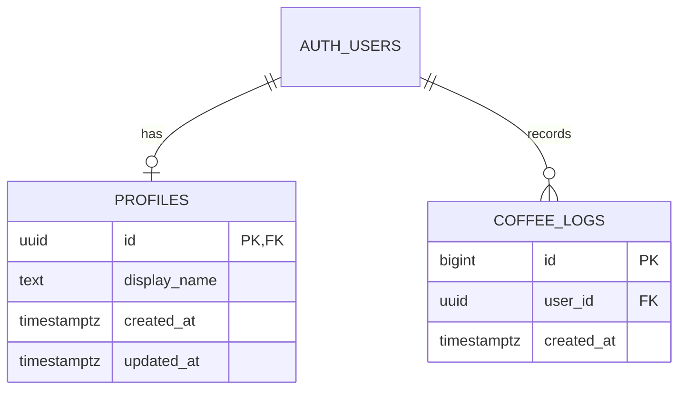

# CaffAlert: turning a coffee diary into an auditable data product

CaffAlert is a personal project by František Bujnovský, a web analyst working with GA4, GTM, SQL and data quality. It connects a small event model to user-facing metrics in a Flutter web application and an Android companion. The useful analytical question is simple: **when and how often does a person record coffee?** The model cannot answer how much caffeine they consumed or how it affected their health.

This case study describes the implementation in this repository. It reports no production adoption, performance or business-impact figures. The SQL examples are proposed analyses, not additional features already present in the dashboard.

## Data model

The three [migrations](../supabase/migrations/) define two public tables and supporting functions:

| Table | Grain and fields | Integrity |
| --- | --- | --- |
| `profiles` | One profile per account: `id uuid`, nullable `display_name text`, `created_at timestamptz`, `updated_at timestamptz` | `id` is both primary key and foreign key to `auth.users`; name must be null or have trimmed length 1–80 |
| `coffee_logs` | One recorded coffee: `id bigint`, `user_id uuid`, `created_at timestamptz` | Identity primary key; non-null user and timestamp; foreign key to `auth.users` |

Both foreign keys cascade on account deletion. A trigger creates a profile on sign-up; another updates `profiles.updated_at`. Both timestamp columns in profiles default to database `now()`. A coffee timestamp also defaults to database `now()`, but the application explicitly supplies its device time in UTC. The `(user_id, created_at DESC, id DESC)` index matches the per-user history query. Records are ordered by timestamp then ID descending for deterministic ties.



`created_at` on a coffee is the editable event time, not a separate immutable ingestion time. There is no drink size, caffeine dose, device identifier, persisted time zone or edit history. The seeded database contains no user data. The Czech operations guide explains that the schema reconstructs a clean database; historical accounts/data from the unavailable original backend are not recovered.

## Metric definitions

Sources: [CoffeeMetrics](../lib/coffee_metrics.dart), [CoffeeStatsProvider](../lib/coffee_stats_provider.dart), [dashboard rendering](../lib/dashboard_screen.dart), and [repository query](../lib/coffee_repository.dart).

Let `L` be the fetched list of records for the current user, sorted newest first, and `T` the subset whose timestamp has the same local year/month/day as `now`. All counts below are counts of records, not milligrams.

| Displayed value | Exact definition |
| --- | --- |
| Coffees today | `length(T)` |
| Coffees this month | Count of `L` matching the local year and month of `now` |
| Total coffees | `length(L)` |
| First coffee today | Minimum timestamp in `T`; unavailable if empty; rendered as local hours/minutes |
| Last coffee today | Maximum timestamp in `T`; unavailable if empty; rendered as local hours/minutes |
| Average interval today | Sort `T` ascending; sum each adjacent UTC timestamp difference truncated to whole seconds, then integer-divide by `length(T) − 1`. Unavailable for fewer than two records. The card further truncates to whole minutes. |
| Coffee status | Daily count 0: `noCoffeeToday`; 1–3: `calm`; 4–5: `coffeeShift`; 6–9: `espressoDrive`; 10+: `legend`, rendered with localized labels |
| CAF countdown | If `L` is empty: zero; otherwise `max(0, D − (now UTC − L.first.createdAt))` |
| CAF level | Round `100 × remaining.inMilliseconds / D.inMilliseconds`, then clamp to 0–100 |

`D` defaults to four hours, with a positive `CAFF_LEVEL_DURATION_SECONDS` build-time override; invalid non-positive settings fall back to four hours. Every new coffee restarts the countdown from that event, without accumulating previous drinks. Removing the newest entry exposes the next newest timestamp. CAF is a playful fictional metric, not a pharmacokinetic model, health measurement or medical recommendation. Status thresholds are also game labels.

The provider ticks every second and recalculates metrics from its current list. It fetches logs and profile on refresh; Realtime changes trigger another fetch. The Android widget receives the latest timestamp and countdown duration after refresh. These are client calculations, not precomputed SQL aggregates.

## Time zones, midnight and DST

Coffee timestamps are parsed into UTC in the model and written as UTC ISO-8601 values to PostgreSQL `timestamptz`. The device's local time zone determines day/month grouping and displayed clock times through `toLocal()`; there is no account-level reporting zone.

At local midnight, the next provider tick moves the daily grouping into the new calendar date without a database write. Month counts likewise use calendar year/month, not a fixed duration. The CAF countdown continues across midnight because it uses elapsed UTC time.

DST days can be 23 or 25 hours. Calendar-date grouping follows local date conversion, while adjacent intervals, countdown and the edit window use elapsed instants. A four-hour countdown therefore remains four elapsed hours over a clock change. An edit uses a local date/time picker and constructs a local `DateTime`; there is no explicit interface for choosing between repeated fall-back times or explaining nonexistent spring-forward times. Travelling or changing the device time zone can regroup historical daily counts. Client clock skew can affect inserted timestamps and CAF values.

The current tests use fixed dates and cover local day/month calculations, but do not explicitly exercise DST transitions, a live midnight rollover or changing device zones. The SQL examples below choose `Europe/Prague` explicitly for reproducibility; this matches the UI only when the device uses that zone.

## Data quality and security

RLS is enabled on both public tables. Anonymous clients have no table access. Authenticated users can select/insert/update their own profile and select/insert/delete their own coffee rows. Coffee updates require ownership and an original timestamp within the last 24 hours; the replacement timestamp must be between server `now() − 24 hours` and `now()`. Both `USING` and `WITH CHECK` enforce the update policy.

`delete_latest_coffee()` is a security-invoker function that selects the authenticated user's latest timestamp/ID and deletes that record. `delete_own_account()` is security-definer with an empty search path; it derives the target from `auth.uid()` and removes that account, with cascading profile/log deletion. Execution is restricted to authenticated users. The client uses a publishable/anon key; a privileged service-role key must never be embedded in a build.

The [pgTAP suite](../supabase/tests/database/caff_alert_rls_test.sql) contains **14 assertions**: table/primary-key existence, own-row visibility, another user's inability to read/update/delete a coffee, scoped latest-coffee deletion, recent update acceptance, old update rejection, and account deletion. It runs inside a transaction and rolls back. It does not explicitly assert every policy, anonymous denial, profile isolation, invalid names, future timestamp rejection on update, or deletion cascades. Those are implementation properties to cover more thoroughly, not tested guarantees claimed here.

There are useful constraints and important boundaries:

- Foreign keys prevent orphan records; primary keys identify events; the name constraint bounds profile text.
- Timestamp inserts are not constrained to the present/past. Owners can insert arbitrary timestamps through the API; a future timestamp may produce more than a full duration of remaining time even though CAF percentage is capped at 100.
- The UI only offers individual edits/removals for the past 24 hours, but the database delete policy allows owners to delete any of their own records. The insert policy does not prevent backdated records.
- There is no idempotency key or uniqueness rule for a coffee event. The provider blocks overlapping mutations within its instance, but retries or multiple clients can create duplicates.
- RLS protects per-user access; a UI filter alone would not. Privileged reporting access requires separate authorization and care with personal timestamps.

## Example analyst queries

These are read-only PostgreSQL queries for an authenticated user's RLS-scoped session: `auth.uid()` must be set through the normal authenticated API/session. They return no user rows in a plain unauthenticated SQL session. For a local SQL editor exercise, explicitly replace `auth.uid()` with a local fixture user's UUID. Never add a privileged key to the app to run these queries.

### 1. Daily intake as recorded coffees

No milligram amount is stored. This counts recorded coffees on each observed local date; absent dates are absent rows.

```sql
select
  (created_at at time zone 'Europe/Prague')::date as coffee_date,
  count(*) as recorded_coffees
from public.coffee_logs
where user_id = auth.uid()
group by 1
order by 1;
```

### 2. Rolling seven-calendar-day average, including zero days

Generate a complete date spine from the first record through today and fill gaps. The first six days are excluded from the result so every shown average has seven dates. Future-dated records are excluded.

```sql
with daily as (
  select (created_at at time zone 'Europe/Prague')::date as day,
         count(*) as coffees
  from public.coffee_logs
  where user_id = auth.uid() and created_at <= now()
  group by 1
), spine as (
  select first_day + offset_day as day
  from (select min(day) as first_day from daily) bounds
  cross join lateral generate_series(
    0, (now() at time zone 'Europe/Prague')::date - first_day
  ) as offsets(offset_day)
), rolling as (
  select s.day,
         coalesce(d.coffees, 0) as coffees,
         avg(coalesce(d.coffees, 0)) over (
           order by s.day rows between 6 preceding and current row
         ) as avg_7_days,
         row_number() over (order by s.day) as day_number
  from spine s left join daily d using (day)
)
select day, coffees, avg_7_days
from rolling where day_number >= 7
order by day;
```

### 3. Local time-of-day distribution

The 24 buckets include zero counts. Repeated DST clock hours share the same bucket. Counts represent recorded events, not an exposure-adjusted hourly rate.

```sql
with hourly as (
  select extract(hour from created_at at time zone 'Europe/Prague')::int as hour,
         count(*) as coffees
  from public.coffee_logs
  where user_id = auth.uid()
  group by 1
)
select h.hour, coalesce(c.coffees, 0) as coffees
from generate_series(0, 23) as h(hour)
left join hourly c using (hour)
order by h.hour;
```

### 4. Consecutive dates with at least one record

A streak measures logging continuity, not a recommended consumption habit. Deduplicating dates prevents multiple coffees from extending a streak. Date subtraction uses calendar days across DST.

```sql
with days as (
  select distinct (created_at at time zone 'Europe/Prague')::date as day
  from public.coffee_logs
  where user_id = auth.uid() and created_at <= now()
), islands as (
  select day, day - (row_number() over (order by day))::int as island
  from days
)
select min(day) as start_date, max(day) as end_date, count(*) as days_logged
from islands
group by island
order by start_date;
```

## Known limitations and next steps

The repository fetches the history in one unpaginated query. Local Supabase sets `api.max_rows = 1000`; a backend row cap can silently truncate the fetched list. Consequently “total”, monthly counts and other client metrics describe the fetched data, not guaranteed lifetime history. Pagination or server-side aggregates are the first analytical correctness improvement as history grows. SQL queries above operate on all authorized database rows and may therefore disagree with capped client totals.

There is no immutable event/audit trail, persisted reporting zone, dose/type dimension, deduplication or offline write queue. Deletion and timestamp correction can change historical reports; without snapshots, a past report cannot be exactly reconstructed. The app has no product-analytics event schema or demonstrated GA4/GTM integration in this data flow. Optional Sentry handles error reporting rather than replacing a measurement plan.

The next useful validation work is to cover row-cap behavior, timezone/DST boundaries, skewed/future device clocks and the untested RLS paths. A later measurement plan could define onboarding, first-log and return-use events, with consent and data minimization designed before instrumentation. None of those proposed events or outcomes is claimed as implemented here.
